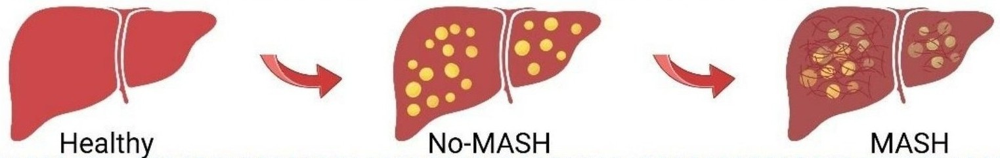
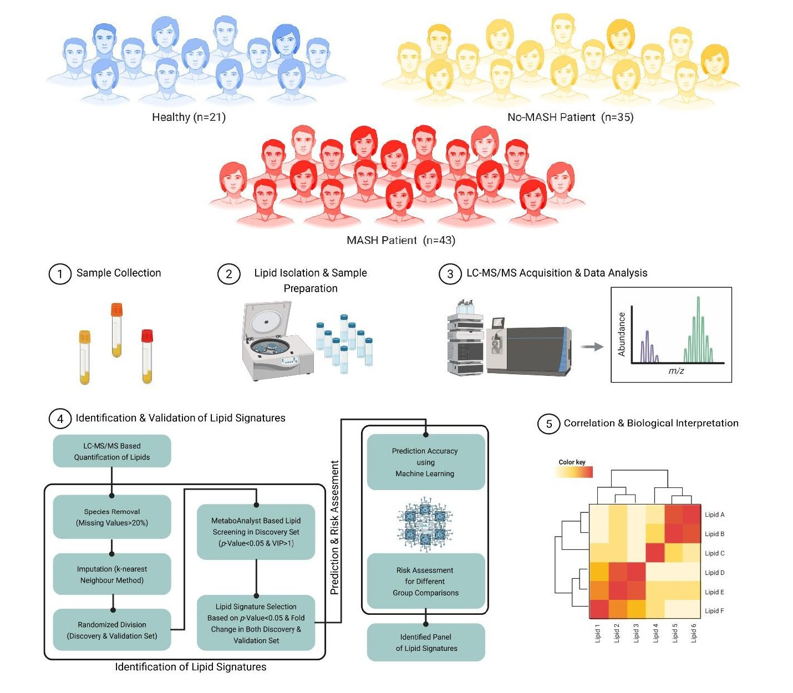

# Identification of plasma lipids as non-invasive signatures for metabolic dysfunction-associated steatotic liver disease

## Introduction

  

Metabolic dysfunction-associated steatotic liver disease (**MASLD**) is a spectrum of liver diseases with global prevalence of 32%. It occurs predominantly in males (40%) compared to females (25%). MASLD spectrum ranges from simple steatosis (≥ 5% hepatic steatosis) as MASLD without steatohepatitis (**No-MASH**) to MASLD with steatohepatitis (**MASH**), which can progress to cirrhosis and hepatocellular carcinoma (HCC). Although liver biopsy remains gold standard invasive method for diagnosing MASLD, it's invasive nature necessitate the development of non- or minimal-invasive diagnostic method for detecting MASLD. 

  

In this study we employed targeted global lipidomic of plasma sample by liquid chromatography-mass spectrometry (LC-MS). Furthermore, we performed machine learning (Random Forest Classifier) based stratification of healthy and MASLD (No-MASH and MASH) individuals using plasma lipidomics data. **The developed model achieved an accuracy >79% and AUC >0.97**.

## Installation and Usage
For installation and usage instructions, please refer to the [doc](https://github.com/rajanbit/Liver_Lipidomics_Paper/tree/main/doc).

## License and Citation
The repository is released under the terms of the **MIT License**. See the [LICENSE](https://github.com/rajanbit/Liver_Lipidomics_Paper/blob/main/LICENSE) file for details.

The paper is published under **CC BY-NC-ND 4.0**.
Please cite [this paper](https://doi.org/10.1038/s44528-026-00039-w) when using models or code from this repository.

**Citation:**
> Khan, A., Rajan, Malakar, D., Maan, K., Biswas, S., Sheikh, S., Bajaj, A., Shalimar, Gupta, I., & Dasgupta, U. (2026). **Identification of plasma lipids as non-invasive signatures for metabolic dysfunction-associated steatotic liver disease**. *Communications Health*, 1(1). https://doi.org/10.1038/s44528-026-00039-w

## Contact
For questions or feedback related to this repo, please reach out:
- [Rajan](https://scholar.google.com/citations?hl=en&user=3rZh86EAAAAJ) – PhD Student, IIT-Delhi, India
- [Ishaan Gupta](https://scholar.google.com/citations?user=H8yFVJYAAAAJ&hl=en) – Assistant Professor, IIT-Delhi, India
